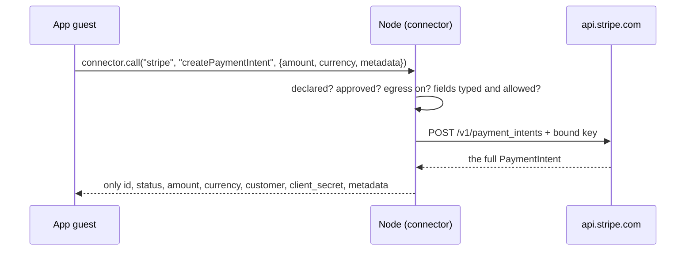

import { Aside } from '@astrojs/starlight/components';

**Task:** take a payment or ask a model from an app, where the key behind it is
worth more than the app: a raw request under an approved prefix can use the key
for anything it allows, and send anything the app can read
([outbound](/build/guides/outbound/)).

A **connector** is node code for one service (`calimero_outbound::Connector`):
a name, a pinned upstream API version, one host, the credential it attaches and
a set of operations. Each operation fixes the method, the path and where each
typed input field goes, and which fields of the answer come back. The app names
an operation and passes JSON; the node builds the HTTP request.

- The app cannot choose a path, a query, a header or a field the operation does
  not take: an unknown field, a value of the wrong type, out of bounds or not
  allowed is refused before anything is sent.
- The answer carries only the operation's declared fields; the service's error
  answers only as its status and error code (`stripe answered 402:
  card_declined`), never its message.
- The request still passes every [gate](/build/guides/outbound/#the-gates) of a
  raw request: the operator's hosts, the approval (of the operation's URL
  prefix), writing runs only, the bounds; the credential is redacted from the
  answer.
- [Egress off](/build/guides/outbound/#egress-off) stops connector calls too:
  while the organization or the instance has it off, every call is refused
  with `EgressOff` before anything is built or sent, whatever was approved.
- An app whose release declares a connector may not reach that connector's
  host with a raw request (`api.stripe.com is reached only through the stripe
  connector this app declares, never by a raw request`): the connector is the
  only way there, so a key bound to that host is used only for the declared
  operations.
- Each call, sent or refused, is in the instance's
  [outbound audit](/build/guides/outbound/#what-the-owner-sees) as the
  connector's host and the operation's declared path
  (`/v1/payment_intents/{id}`, never the id the input filled in), with the
  connector's secret name once attached; a raw request to the connector's host
  is there as `refused`.

## Declare and call

A release declares the connectors it calls in its signed manifest, under
`connectors`: for each, the `operations` it may call and the values each of the
connector's limits allows (`metadata` keys for Stripe, `model`s for OpenAI). With
`meroctl app pack`, write them in the crate's `Cargo.toml`:

```toml
[package.metadata.calimero.connectors.stripe]
operations = ["createPaymentIntent", "retrievePaymentIntent"]
metadata = ["order_id"]

[package.metadata.calimero.connectors.openai]
operations = ["chatCompletion"]
model = ["gpt-4o-mini"]
```

The node refuses the release at install (`400 BAD_CONNECTORS`) for a connector it
does not have, an operation the connector does not have, or a limit no declared
operation takes; at most 8 connectors, 32 operations each, 64 values per limit.

The guest calls one through `calimero:app/connector` (WIT 0.5.8), in Rust
`calimero_sdk::connector::call` (or `call_raw` with the input already JSON).
Like [outbound HTTP](/build/guides/outbound/), from an action, a call, a timer or
an xcall delivery, never a view or `init`; each call counts as one of the run's 8
outbound requests, and a logged run's entry records it (as `CONNECTOR
connector:<name>/<operation>`, the input and the answer), so no replay calls
again. Any refusal comes back as `Connector { message }`. In the SDK's test
harness, `TestApp::mock_connector` answers a connector's calls.



The consent page lists the declared operations and values beside the hosts, and
approving the release's manifest approves the connectors' operation prefixes
(`https://api.stripe.com/v1/payment_intents`) with its `outbound` ones; an update
that adds an operation or a value says so.

## The credential

A connector attaches its key itself, through a credential binding of its own:
the secret it names (`STRIPE_SECRET_KEY`, `OPENAI_API_KEY`), in
`authorization` as `Bearer {}`, on the connector's host. The value is the
instance owner's, its deployment's or the operator's (whose binding must list
that host), as for any [secret](/protocol/secrets/): a release that declares a
connector declares its secret name too, so the owner sets it as
`app_secret_set` sets any other. The app never names,
places or reads it, and a call carries the connector's binding alone, never
one the release declares for its raw requests. A call with no value for it is
refused (`secret STRIPE_SECRET_KEY has no value for this app`) rather than
sent unauthenticated. An input that holds `{{secret:` is refused.

## Stripe

`stripe`, pinned to Stripe API version `2024-06-20` (sent as `Stripe-Version`),
host `api.stripe.com`, form-encoded, as Stripe's
[PaymentIntents](https://docs.stripe.com/api/payment_intents) reference
documents them:

| Operation | Request | Input |
| --- | --- | --- |
| `createPaymentIntent` | `POST /v1/payment_intents` | `amount` (1 to 99 999 999, the smallest currency unit), `currency` (three lowercase letters), `customer` (`cus_…`, optional), `metadata` (optional; only keys the release declares, values ≤ 500 bytes) |
| `retrievePaymentIntent` | `GET /v1/payment_intents/{id}` | `id` (`pi_` then letters, digits and `_`) |

Both answer `id`, `status`, `amount`, `currency`, `customer`, `client_secret`
(what the payer's browser confirms the intent with through Stripe.js; not the
key) and `metadata`, holding only the declared keys.

```json
"connectors": {
  "stripe": {
    "operations": ["createPaymentIntent", "retrievePaymentIntent"],
    "metadata": ["order_id"]
  }
}
```

```rust
let intent = connector::call(
    "stripe",
    "createPaymentIntent",
    &json!({ "amount": 2000, "currency": "usd", "metadata": { "order_id": order.id } }),
)?;
// {"id":"pi_…","status":"requires_payment_method","client_secret":"pi_…_secret_…", …}
```

The node sends exactly:

```text
POST https://api.stripe.com/v1/payment_intents
stripe-version: 2024-06-20
authorization: Bearer <the bound key>
content-type: application/x-www-form-urlencoded

amount=2000&currency=usd&metadata%5Border_id%5D=A-17
```

A refund, a payout or any other Stripe path is out of reach: it is no
operation, and a raw request to `api.stripe.com` is refused.

## OpenAI-compatible chat completions

`openai`, pinned to OpenAI's `v1`
[Chat Completions](https://platform.openai.com/docs/api-reference/chat/create)
API, host `api.openai.com`, a JSON body:

| Operation | Request | Input |
| --- | --- | --- |
| `chatCompletion` | `POST /v1/chat/completions` | `model` (one the instance's owner allows), `messages` (1 to 64 `{role, content}`, role `system`, `user` or `assistant`, content a string ≤ 32 KiB), `max_tokens` (1 to 16 384, optional) |

It answers `content` (the first choice's message) and `usage`
(`prompt_tokens`, `completion_tokens`, `total_tokens`), nothing else. Tools,
streaming, images, `n` and every other field are refused.

```rust
let answer = connector::call(
    "openai",
    "chatCompletion",
    &json!({
        "model": "gpt-4o-mini",
        "messages": [{ "role": "user", "content": question }],
        "max_tokens": 256,
    }),
)?;
// {"content":"…","usage":{"prompt_tokens":9,"completion_tokens":2,"total_tokens":11}}
```

The models are the release's `model` list, shown on the consent page and
approved with it: a model outside it is refused, and with no list every call is.

## Limits

| What | Bound | Constant |
| --- | --- | --- |
| One call's input | 64 KiB, before it is parsed | `MAX_CONNECTOR_INPUT` |
| Values of one limit (metadata keys, models) | 64 | `MAX_LIMIT_VALUES` |
| A call | counts as one outbound request, with the request bounds of [outbound](/build/guides/outbound/#the-gates) | `MAX_HTTP_REQUESTS` |
